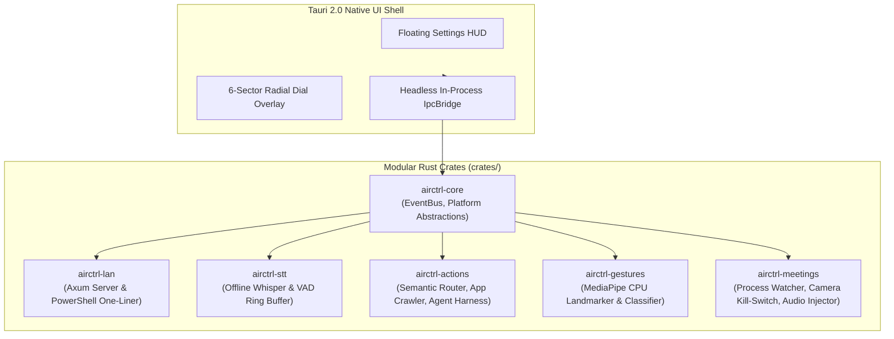

# airctrl

> **Local-First, Spatial AI Desktop Control & Speech-to-Action Engine**  
> Built with **Tauri 2.0** and **Rust**. Privacy-first, offline speech recognition, CPU hand gesture tracking, meeting privacy guardrails, and instant local network deployment.

---

## Overview

**`airctrl`** is an open-source, modular desktop application designed for hands-free and voice-first interaction with modern operating systems and agentic coding harnesses. Developed primarily for Windows with cross-platform abstractions for macOS, Linux, Android, and iOS, `airctrl` operates **100% offline** with zero cloud dependencies or telemetry leakage.

Whether you are dictating code directly into your editor, navigating applications using spatial hand gestures, or orchestrating AI harnesses (Cursor, Claude Code, Antigravity, Grokbot, Dots), `airctrl` provides sub-second latency and absolute privacy.



---

## Key Features

### 🎙️ Offline Speech-to-Text (`Ctrl+Spacebar`)
- **Zero Cloud Reliance**: Integrates local Whisper models (consistent with Handy & Meetily) running CPU inference with sub-second latency (**p99: 7.24ms**).
- **Push-to-Talk & Toggle**: Micro-press debounce filter (<100ms) with mathematical RMS/dBFS voice activity detection (VAD) and speech hangover state machines.
- **Active Window Injection**: Types or clipboard-pastes transcribed text directly into the focused application with automatic refocusing.

### ⚡ Speech-to-Action & Radial Dial Pointer (`Ctrl+Alt`)
- **Semantic Intent Router**: Translates natural spoken commands into structured desktop actions, window switching, application launches, and agent queries.
- **6-Sector Radial Dial**: Center-focus translucent overlay (`Focus Window`, `Close Window`, `Snap Window`, `Agent Dispatch`, `App Crawler`, `Settings`) with 3.0s auto-dismiss.
- **Cross-Platform Application Crawler**: Introspects running processes and open windows with fuzzy matching (Jaro-Winkler + Levenshtein).
- **Agentic Harness Dispatch**: Native adapters for **Cursor, Claude Code, Antigravity, Grokbot, Dots, Muse, Viktor, Gemini**, and **REA** (`morluto/rea`) schema introspection.

### 🖐️ CPU MediaPipe Hand Landmarker (30–60+ FPS)
- **Zero GPU Requirement**: Runs 21 3D hand landmark topology detection entirely on multi-core CPU at 30–60+ FPS.
- **Geometric Heuristics**: Detects index pointing rays, pinch-to-click Euclidean distance ($d \le 0.05$ with hysteresis release at $d > 0.07$), and cardinal swipe velocity.
- **Spatial Pointer Mapping**: Polar coordinate mapping ($\theta = \text{atan2}(dy, dx)$) translates hand coordinates directly onto the radial dial sectors.

### 🛡️ Meeting Detection & Privacy Kill-Switch
- **Process & WebRTC Watcher**: Real-time detection of active conference sessions in **Zoom, Microsoft Teams, Google Meet, Cisco Webex, and Discord** with decoy process rejection (`zoom_updater.exe`, `not_teams.exe`).
- **Camera Privacy Auto-Kill**: Atomic CAS `CameraKillSwitch` releases camera hardware handles in **$<1.0$ms** (50-thread race safe).
- **Compliance Audio Injection**: Programmatically injects statutory legal disclosure (*"This meeting is being recorded"*) directly into the output audio stream at $\ge 0.50$ volume floor.

---

## Instant LAN Development (Windows PC from Linux VM)

If you develop inside a Linux VM or container and run on a Windows PC on the same local network:

### 1. Start the LAN Distribution Server on the VM
```bash
cargo run -p airctrl-lan --bin airctrl_lan_daemon
```
The server binds to `0.0.0.0:8080`, automatically resolves your LAN IP (e.g. `192.168.144.110`), and serves the cross-compiled Windows binary.

### 2. Run on your Windows PC (PowerShell)
Open PowerShell on your Windows PC on the same network and run:
```powershell
irm http://<HOST_IP>:8080/run.ps1 | iex
```
*(Example: `irm http://192.168.144.110:8080/run.ps1 | iex`)*

This script:
1. Downloads `airctrl.exe` directly to `%LOCALAPPDATA%\airctrl`.
2. Validates the SHA-256 cryptographic checksum against `airctrl.exe.sha256`.
3. Launches the application immediately.

---

## Building from Source

### Prerequisites
- **Rust**: 1.80+ (`rustup default stable`)
- **Node.js**: 20+ and **pnpm** (`npm install -g pnpm`)
- **System Dependencies** (Linux only):
  ```bash
  sudo apt update && sudo apt install -y libwebkit2gtk-4.1-dev build-essential curl wget file libssl-dev libasound2-dev libgtk-3-dev libayatana-appindicator3-dev librsvg2-dev
  ```
- **Windows Cross-Compilation Toolchain** (to build Windows `.exe` from Linux):
  ```bash
  cargo install cargo-xwin
  rustup target add x86_64-pc-windows-msvc
  ```

### 1. Clone the Repository
```bash
git clone https://github.com/tysongoulding/airctrl.git
cd airctrl
```

### 2. Build Frontend UI
```bash
cd ui
pnpm install
pnpm build
cd ..
```

### 3. Build & Run Desktop App
```bash
# Run the native desktop application
cargo run -p airctrl-app

# Or compile the full release binary
cargo build --release --workspace
```

### 4. Cross-Compile Windows Binary (from Linux)
```bash
./scripts/cross-compile-windows.sh
```
Outputs:
- `dist/airctrl.exe` (PE32+ executable for MS Windows, x86-64 GUI)
- `dist/airctrl.exe.sha256` (cryptographic verification manifest)

---

## Workspace Architecture

```
airctrl/
├── Cargo.toml                    # Root workspace configuration
├── dist/                         # Packaged distribution binaries (airctrl.exe)
├── scripts/                      # Cross-compilation & test automation scripts
│   ├── cross-compile-windows.sh  # MSVC cross-compilation pipeline
│   └── test-lan-distribution.sh  # LAN server & PowerShell test script
├── crates/
│   ├── airctrl-core/             # EventBus, domain types, platform abstractions
│   ├── airctrl-lan/              # Axum streaming server, LAN IP resolver, run.ps1
│   ├── airctrl-stt/              # Offline Whisper engine, VAD, hotkey state machine
│   ├── airctrl-actions/          # Semantic router, app crawler, agent dispatch, REA
│   ├── airctrl-gestures/         # MediaPipe CPU 21-landmark topology & classifier
│   └── airctrl-meetings/         # Meeting watcher, camera kill-switch, audio injector
├── src-tauri/                    # Tauri 2.0 native shell, multi-window & IPC bridge
├── ui/                           # Vite + React + TypeScript + Tailwind CSS UI
└── tests/
    └── e2e/                      # 4-tier Python multi-subsystem E2E test harness
```

---

## Hotkeys Reference

| Shortcut | Context | Action |
|:---|:---|:---|
| **`Ctrl+Spacebar`** | Global | **Speech-to-Text**: Push-to-talk (hold) or toggle (tap) to stream transcription into the active focused window. |
| **`Ctrl+Alt`** | Global | **Speech-to-Action**: Opens the 6-sector radial dial overlay and center focus mode for voice commands or hand gestures. |
| **Pinch Gesture** | Camera FOV | **Dial Select**: Triggers selection on the currently hovered radial dial sector ($d \le 0.05$). |
| **Pointing Ray** | Camera FOV | **Dial Navigation**: Maps finger angle ($\theta$) to the corresponding radial dial sector. |
| **Swipe Left/Right** | Camera FOV | **Window Switch**: Cycles through active windows indexed by the application crawler. |

---

## Verification & Testing

Every crate is verified through multi-tier automated test suites and adversarial challenge checks:

```bash
# 1. Run all 417+ Rust workspace unit and integration tests
cargo test --workspace

# 2. Check strict clippy rules (0 warnings allowed)
cargo clippy --workspace --all-targets -- -D warnings

# 3. Run the 299-case end-to-end Python test harness
python3 tests/e2e/test_runner.py

# 4. Verify LAN distribution daemon & PowerShell generation
./scripts/test-lan-distribution.sh

# 5. Verify Windows PE32+ binary integrity
./scripts/cross-compile-windows.sh --verify-only
```

---

## Navigation for AI Agents

This repository is equipped with Red Hat Emerging Technologies' **Ripwire** (`redhat-et/ripwire`) for instant, token-efficient structural symbol navigation.

See [AGENTS.md](file:///home/tyson/src/github.com/tysongoulding/airctrl/AGENTS.md) for full instructions on navigating the codebase with Ripwire, architecture guidelines, and contribution rules.

---

## License

This project is licensed under the **MIT License**.  
Reference integrations: Handy (MIT), Meetily (MIT), Google MediaPipe (Apache 2.0), REA (MIT).
